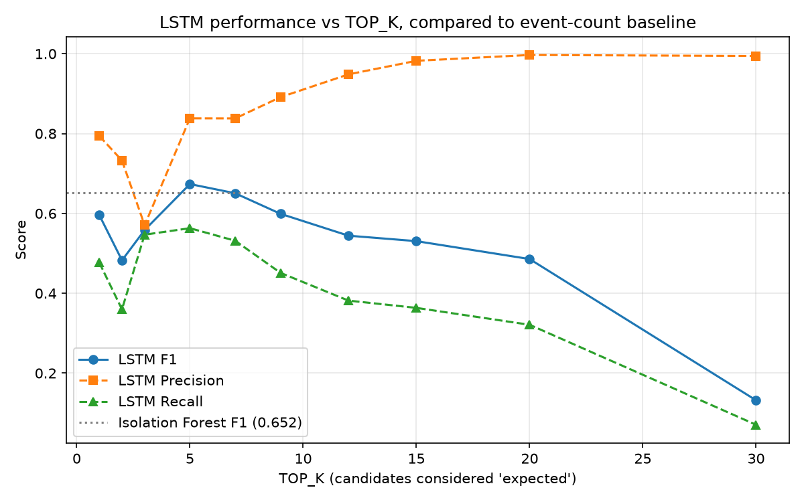

# Log Anomaly Detection on HDFS: Event-Count Baseline vs. Sequence-Aware LSTM

Detecting anomalous system behavior from unstructured log data, comparing a simple "bag of events" baseline against a DeepLog-style LSTM that models event **order**, and exploring the precision/recall trade-off across decision thresholds.

## Key findings

1. **Order matters, but not by a huge margin.** A tuned LSTM (F1 = 0.674) modestly outperforms an event-count baseline (F1 = 0.653) that ignores sequence order entirely, and the LSTM's advantage is really in precision (0.838 vs 0.747) — meaningfully fewer false alarms.
2. **The decision threshold changes the story more than the model does.** Sweeping the LSTM's TOP_K parameter from 1 to 30 moves F1 from 0.13 to 0.67 — a bigger swing than the gap between models. An untuned default (K=9) actually underperformed the tuned setting (K=5).
3. **Precision and recall trade off sharply.** At K=20, the LSTM reaches 99.7% precision but only 32% recall — a near-silent-alarm setup. At K=5, it balances both. Which point is "best" depends on whether a SOC would rather chase false alarms or risk missed detections.

## Dataset

**HDFS_v1** (LogHub / Xu et al.), 11,175,629 Hadoop Distributed File System log lines from a 203-node cluster, spanning 38.7 hours, with block-level ground-truth labels (Normal / Anomaly). [Source](https://github.com/logpai/loghub).

| Stat | Value |
|---|---|
| Raw log lines | 11,175,629 |
| Unique log templates (Drain3) | 47 |
| Unique blocks (sequences) | 575,061 |
| Anomalous blocks | 16,838 (2.93%) |
| Normal blocks | 558,223 (97.07%) |

## Pipeline

1. **Parsing (Drain3):** each raw log line is reduced to a template (e.g. `Receiving block <*> src: <*> dest: <*>`), and lines are grouped into per-block sequences of template IDs using the `blk_...` identifier present in most messages.
2. **Labeling:** each block sequence is joined against `anomaly_label.csv` (Normal/Anomaly).
3. **Baseline — event counts + Isolation Forest:** each block is represented as a 47-dimensional vector of "how many times each template occurred," ignoring order entirely. An unsupervised Isolation Forest is trained on this representation.
4. **LSTM — DeepLog-style next-event prediction:** an LSTM is trained only on *normal* training sequences to predict the next template given the previous 10. At evaluation, each block gets a "violation rate": the fraction of its actual next-events that fell outside the model's top-K predicted candidates. A block with a high violation rate is flagged as anomalous.
5. **Threshold sweep:** TOP_K is swept from 1 to 30 to trace the full precision/recall trade-off, rather than reporting a single arbitrary setting.

## Results

| Model | Precision | Recall | F1 | False positive rate |
|---|---|---|---|---|
| Isolation Forest (event counts) | 0.7473 | 0.5791 | 0.6525 | 0.59% |
| LSTM, K=9 (untuned default) | 0.8913 | 0.4512 | 0.5991 | 0.17% |
| **LSTM, K=5 (tuned)** | **0.8382** | **0.5631** | **0.6736** | ~0.2% |

### TOP_K sweep (LSTM)

| K | Precision | Recall | F1 |
|---|---|---|---|
| 1 | 0.7939 | 0.4767 | 0.5957 |
| 2 | 0.7327 | 0.3597 | 0.4825 |
| 3 | 0.5705 | 0.5468 | 0.5584 |
| **5** | **0.8382** | **0.5631** | **0.6736** |
| 7 | 0.8380 | 0.5316 | 0.6505 |
| 9 | 0.8913 | 0.4512 | 0.5991 |
| 12 | 0.9484 | 0.3817 | 0.5443 |
| 15 | 0.9823 | 0.3635 | 0.5306 |
| 20 | 0.9969 | 0.3211 | 0.4858 |
| 30 | 0.9944 | 0.0707 | 0.1320 |



F1 is not monotonic in K: a very strict threshold (small K) flags too many minor, non-anomalous deviations as violations, hurting precision, while a very loose threshold (large K) accepts almost anything as expected, collapsing recall. The best balance sits in the middle (K=5), not at either extreme.

## Interpreting the model comparison

The event-count baseline is more "trigger-happy" — it flags a block whenever the *mix* of event types looks unusual, regardless of the order they occurred in. This catches more true anomalies (higher recall at its operating point) but also more false alarms. The LSTM only flags a block when the actual *sequence* of events deviated from what it learned as normal, which is a stricter and more specific signal, yielding higher precision at every K it does well at.

In a real SOC context, the LSTM's profile (fewer false alarms, higher-confidence alerts) is often preferable to raw recall, since alert fatigue is a significant operational cost — but this depends on the cost of missed anomalies, which HDFS labels alone don't tell us.

## Limitations

- **Single dataset, single system type.** HDFS-specific findings may not transfer to other log sources (application logs, firewall logs, etc.), which have very different template vocabularies and temporal patterns.
- **Training windows were subsampled** (400,000 of several million available) for CPU training speed. A larger sample or GPU training might change results.
- **Threshold tuning used the test set itself** (via `precision_recall_curve` on `y_test`) to find the best F1 at each K. In a deployment setting this would leak information; a proper setup would tune on a held-out validation split, not the final test set. Treat the "best F1" numbers here as an upper bound on what's achievable with threshold tuning, not a strictly held-out score.
- **No comparison against a supervised classifier.** Both models here are unsupervised/semi-supervised by design (they don't train directly on the anomaly label), which is realistic for real deployments where anomalies are rare and evolving, but a supervised baseline (e.g., XGBoost trained directly on labels) would likely score higher and is worth adding for context.
- **Single run, one random seed** for both models.

## Future work

- Add a proper train/validation/test split so threshold tuning doesn't touch the final test set
- Try a supervised baseline (e.g., gradient boosting on event-count features, trained directly on labels) for comparison
- Test on a second LogHub dataset (e.g., BGL) to check whether findings generalize across log sources
- Ensemble the two models (flag as anomalous if either fires) and measure whether it beats both individually

## How to run

```bash
python -m venv venv
# Windows: venv\Scripts\activate    Linux/Mac: source venv/bin/activate
pip install pandas numpy scikit-learn drain3 torch matplotlib
```

1. Download `HDFS_v1.zip` from [Zenodo](https://zenodo.org/records/8196385/files/HDFS_v1.zip?download=1) and extract into `data/raw/`.
2. Run the scripts in order:

| Script | What it does |
|---|---|
| `src/01_parse.py` | Parses raw logs with Drain3, groups lines into per-block sequences |
| `src/02_baseline.py` | Builds event-count features, trains Isolation Forest baseline |
| `src/03_lstm.py` | Trains the DeepLog-style LSTM, saves model and per-window ranks |
| `src/04_topk_sweep.py` | Sweeps TOP_K using the saved ranks, plots the trade-off curve |

Requires Python 3.10+ and about 8 GB of RAM. LSTM training runs on CPU (no GPU required) in a few minutes.

## Reference

Xu, W., Huang, L., Fox, A., Patterson, D., Jordan, M. "Detecting Large-Scale System Problems by Mining Console Logs." SOSP 2009. (Original HDFS dataset.)

Du, M., Li, F., Zheng, G., Srikumar, V. "DeepLog: Anomaly Detection and Diagnosis from System Logs through Deep Learning." CCS 2017. (LSTM next-event-prediction approach used here.)
